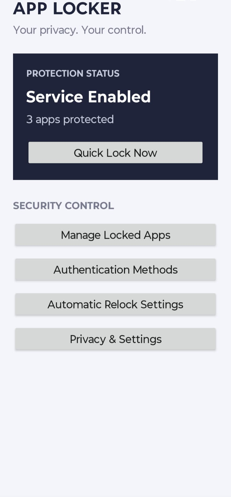
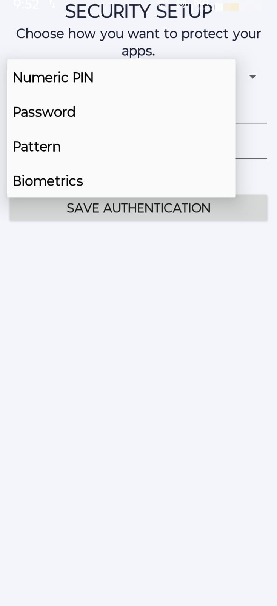
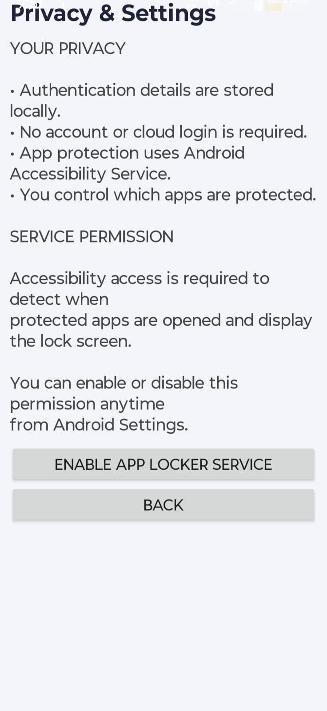

# 🔐 AppLocker

A native Android application locker built with **Kotlin**. AppLocker helps protect selected applications using biometric authentication, PIN, password, or pattern-based authentication.

## ✨ Features

* **App selection:** Choose which installed applications you want to protect.
* **Multiple authentication methods:**
  * Fingerprint / biometric authentication (where supported)
  * Numeric PIN
  * Password
  * Pattern lock
* **Automatic relocking:** Configure how long an application can remain unlocked after leaving it.
* **Native authentication screen:** Uses a dedicated Android Activity for authentication.
* **Accessibility-based app detection:** Detects when a protected application is opened or left.
* **Screen-lock handling:** Supports relocking when the device screen turns off.
* **Local operation:** Designed to work without requiring a cloud account.

## 🛠️ Built With

| Technology | Purpose |
|----|----|
| Kotlin | Main programming language |
| Android SDK | Native Android development |
| Gradle | Build automation |
| Android AccessibilityService | Foreground application detection |
| AndroidX Biometric | Biometric authentication |
| AndroidX AppCompat | Android compatibility support |

## 📱 Compatibility

* **Minimum Android SDK:** 23 (Android 6.0)
* **Compile SDK:** 35
* **Target SDK:** 35

## 🚀 Building the Project

### Prerequisites

* JDK 17
* Android SDK
* Android SDK Platform 35
* Android Build Tools 35.0.0
* Gradle 8.7

### Build Instructions

**1. Clone the repository**

```bash
git clone https://github.com/shivam-tiwari-dev/AppLocker.git
```

**2. Navigate to the project directory**

```bash
cd AppLocker
```

**3. Build the debug APK**

```bash
gradle assembleDebug
```

**4. Locate the generated APK**

```text
app/build/outputs/apk/debug/app-debug.apk
```

**5. Install on a connected Android device**

```bash
adb install -r app/build/outputs/apk/debug/app-debug.apk
```

## ⚙️ Initial Setup


1. Install and open AppLocker.
2. Configure your preferred authentication method.
3. Select the applications you want to protect.
4. Enable the AppLock Accessibility Service when prompted.
5. Configure your automatic relock preference.

## 🔒 Privacy and Permissions

AppLocker uses Android's `AccessibilityService` to detect application transitions and determine when a protected application requires authentication.

The accessibility service is configured with `canRetrieveWindowContent=false`, meaning it does not retrieve the contents of other applications' windows.

Accessibility permission must be explicitly enabled by the device user through Android settings.

AppLocker is designed for local operation and does not require a cloud account.

## 📸 Screenshots

### Home Screen

 

### Authentication Screen

 

### Privacy and Security

 

## ⚠️ Limitations

* AppLocker is a personal, sideloaded Android project.
* Its protection depends on the accessibility service remaining enabled.
* It cannot guarantee protection if the app is force-stopped, uninstalled, or its required permissions are disabled.
* Biometric authentication depends on device hardware and Android support.
* AppLocker is a personal project and has not undergone an independent security audit.

## 🛣️ Future Improvements

* Further improve foreground application detection.
* Refine automatic relocking behavior.
* Improve the user interface and settings experience.
* Explore additional privacy and security enhancements.

## 👨‍💻 Author

**Shivam Tiwari**

GitHub: [@shivam-tiwari-dev](https://github.com/shivam-tiwari-dev)


---

*Built as a hands-on Android development project while learning Kotlin and native application development.*